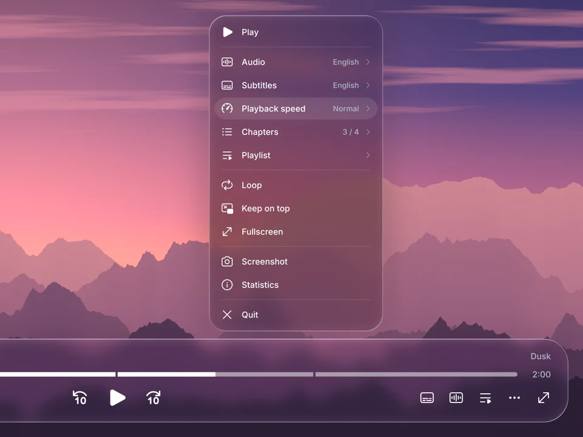
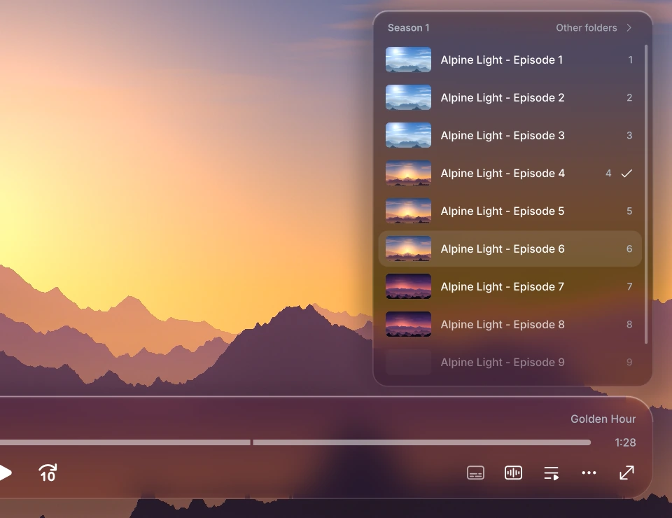

<p align="center">
  
</p>

<p align="center">
  A sleek and modern glassmorphic OSC for <a href="https://mpv.io">mpv</a>. This project is a fork of <a href="https://github.com/Samillion/ModernZ">ModernZ</a> that adds translucent glass panels, track menus and seekbar thumbnails while preserving the core standards of mpv's OSC.
</p>

<p align="center">
  
  
  
</p>

<p align="center">
  <a href="#installation"><b>Install</b></a> &nbsp;·&nbsp;
  <a href="#configuration">Configure</a> &nbsp;·&nbsp;
  <a href="#thumbz">Thumbz</a> &nbsp;·&nbsp;
  <a href="#controls">Controls</a> &nbsp;·&nbsp;
  <a href="docs/USER_OPTS.md">All options</a> &nbsp;·&nbsp;
  <a href="#credits">Credits</a>
</p>

<br>

<p align="center">
  
</p>

## Features

- **Liquid Glass panel.** The controls float on clear glass that bends the video at its rounded edges and catches light along the rim. Over bright video the glass darkens so the controls stay readable.
- **Glass menus.** Audio, subtitles, playlist, chapters, speed and audio output open above their buttons; the ⋯ button holds the rest.
- **Right-click menu.** Opens at the pointer in place of mpv's own menu.
- **Folder playlist.** With one file playing, the playlist lists the other videos in its folder in order, with thumbnails. **Other folders** opens any other folder.
- **Thumbz.** Seekbar previews from a thumbnailer written for ModernGlass.
- **Accessibility.** `glass_reduce_transparency`, `glass_increase_contrast` and `reduce_motion`.

<table>
  <tr>
    <td width="50%"></td>
    <td width="50%"></td>
  </tr>
  <tr>
    <td align="center"><sub>Right-click menu</sub></td>
    <td align="center"><sub>Folder playlist</sub></td>
  </tr>
  <tr>
    <td width="50%"></td>
    <td width="50%"></td>
  </tr>
  <tr>
    <td align="center"><sub>Audio tracks</sub></td>
    <td align="center"><sub>Image viewer</sub></td>
  </tr>
</table>

## Installation

Copy these into your mpv folder (`%APPDATA%\mpv` on Windows, `~/.config/mpv` on Linux, `~/Library/Application Support/mpv` on macOS):

| From this repository | To |
| --- | --- |
| `modernz.lua`, `thumbz.lua` | `scripts/` |
| `fonts/Inter-Medium.ttf`, `fonts/Inter-SemiBold.ttf` | `fonts/` |
| `modernz.conf`, `thumbz.conf` (optional) | `script-opts/` |

Then add to `mpv.conf`:

```ini
osc=no
vo=gpu-next
video-sync=display-resample
```

The glass effects need `vo=gpu-next`. With `border=no` ModernGlass draws its own window buttons.

Coming from ModernZ, your `modernz.conf` and `input.conf` keep working, and `modernz-icons.ttf` and `thumbfast.lua` can be deleted.

## Configuration

Options go in `script-opts/modernz.conf`, for example:

```ini
glass_opacity=20
panel_max_width=1400
seekbarfg_color=#0A84FF
```

The [options guide](docs/USER_OPTS.md) lists every option. ModernZ's other layouts (`classic`, `compact`, `mini`, `seekbar`) are available with `layout=`, [translations](docs/TRANSLATIONS.md) with `language=`, and ModernZ's [extras](extras/) work as well.

## Thumbz

Thumbz renders thumbnails in a second mpv in the background. It starts on thumbnails across the file when the controls appear, shows the closest one while you move along the seekbar, and renders the exact frame when you stop. It also makes the thumbnails in the folder and playlist menus.

| | Thumbfast | Thumbz |
| --- | :---: | :---: |
| Time for 24 exact thumbnails | 8.2 s | 6.8 s |
| CPU time used | 12.0 s | 10.7 s |

<details>
<summary>How this was measured</summary>
<br>


<sub>Exact frames at 24 points of a 5-minute 1080p H.264 video, requested one after another. Default settings for both, software decoding on two CPU cores, median of 5 runs. Thumbfast skips the deblocking filter when it decodes in software, which saves time and leaves blocky frames late in long gaps between keyframes. Thumbz decodes every frame exactly. Thumbz also uses the player's hardware decoding for 1080p and larger videos when it is turned on.</sub>
</details>

## Controls

Left click runs a button's main action, right click a second one, and middle click or <kbd>Shift</kbd>+click a third. A right click anywhere else, <kbd>Menu</kbd> or <kbd>Shift</kbd>+<kbd>F10</kbd> opens the right-click menu. The [controls guide](docs/CONTROLS.md) lists them all.

## Credits

Based on [ModernZ](https://github.com/Samillion/ModernZ) by Samillion, which comes from [dexeonify/ModernX](https://github.com/dexeonify/mpv-config/blob/main/scripts/modernx.lua), [cyl0/ModernX](https://github.com/cyl0/ModernX), [maoiscat/mpv-osc-modern](https://github.com/maoiscat/mpv-osc-modern) and mpv's [osc.lua](https://github.com/mpv-player/mpv/blob/master/player/lua/osc.lua). Font: [Inter](https://rsms.me/inter/) by Rasmus Andersson. Icons: [Fluent System Icons](https://github.com/microsoft/fluentui-system-icons) by Microsoft and [Material Symbols](https://github.com/google/material-design-icons) by Google. The screenshots show The Ghost in the Shell (2026), episode 1.

## License

[LGPL-2.1](LICENSE), like mpv's osc.lua. Inter is under the [SIL Open Font License 1.1](fonts/Inter-LICENSE.txt), Fluent System Icons under [MIT](https://github.com/microsoft/fluentui-system-icons?tab=MIT-1-ov-file#readme) and Material Symbols under [Apache 2.0](https://github.com/google/material-design-icons?tab=Apache-2.0-1-ov-file#readme).
