<p align="center">
  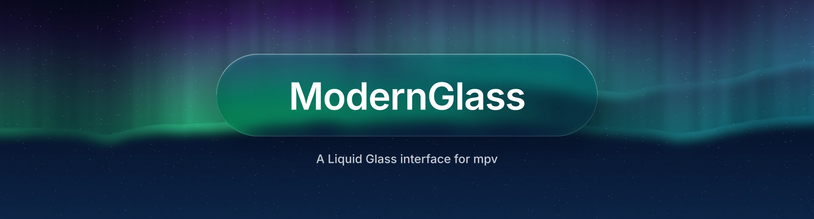
</p>

<p align="center">
  A sleek and modern glassmorphic OSC for <a href="https://mpv.io">mpv</a>. This project is a fork of <a href="https://github.com/Samillion/ModernZ">ModernZ</a> that adds translucent glass panels, track menus and seekbar thumbnails while preserving the core standards of mpv's OSC.
</p>

<p align="center">
  
  
  
</p>

<p align="center">
  <a href="#installation"><b>Install</b></a> &nbsp;·&nbsp;
  <a href="#configuration">Configure</a> &nbsp;·&nbsp;
  <a href="#thumbz">thumbz</a> &nbsp;·&nbsp;
  <a href="#controls">Controls</a> &nbsp;·&nbsp;
  <a href="docs/USER_OPTS.md">All options</a> &nbsp;·&nbsp;
  <a href="#credits">Credits</a>
</p>

<br>

<p align="center">
  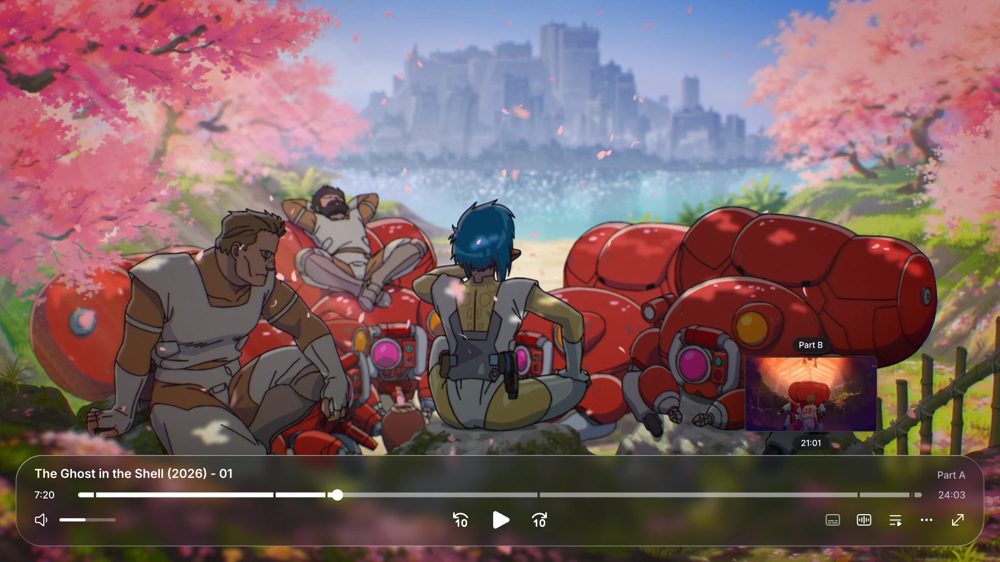
</p>

<br>

## Features

- **Glass panel.** The playback controls sit on a floating panel with rounded corners. With `vo=gpu-next`, a shader blurs the video behind the panel, distorts it slightly near the edges, adds a highlight along the top edge and draws a shadow under the panel.
- **Brightness adjustment.** Over bright video the panel is darkened and its shadow is made stronger, so white text and icons stay readable.
- **Menus.** The audio, subtitle, playlist, chapter, speed and audio output lists open as menus above their buttons. The ⋯ button opens a menu with playback speed, chapters, audio output, loop, keep on top, screenshot and statistics.
- **thumbz.** A seekbar thumbnailer written for ModernGlass that shows a preview frame above the seekbar while you hover it. See [thumbz](#thumbz) for how it works and how it compares to thumbfast.
- **Size.** The controls scale with the window up to a maximum size (`vidscale_max`), which is multiplied by the system's display scaling. On large monitors they stay the size they have on a 1080p screen.
- **Accessibility options.** `glass_reduce_transparency` makes the panels nearly opaque, `glass_increase_contrast` makes them black with a visible border, and `reduce_motion` turns off the spring and scale animations.
- **GPU use.** The blur is computed on a copy of the frame scaled down to 270 rows, and the shader is turned off while the controls are hidden.

## Gallery

<table>
  <tr>
    <td width="50%">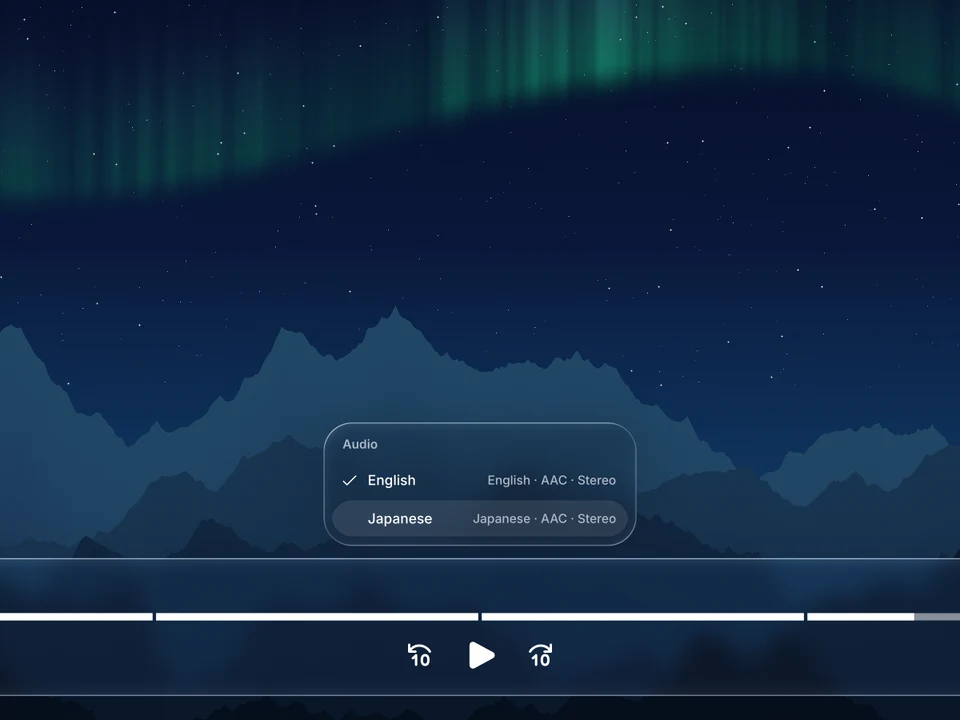</td>
    <td width="50%">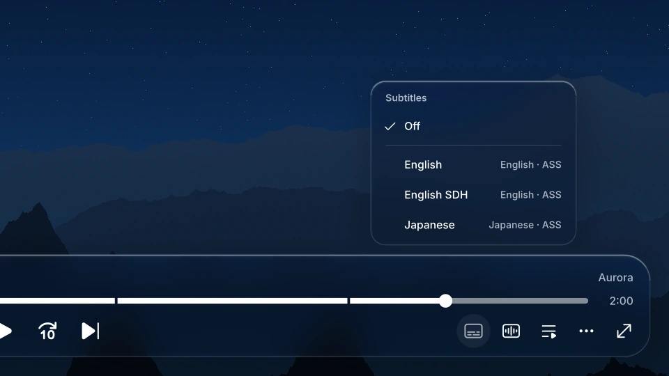</td>
  </tr>
  <tr>
    <td align="center"><sub>Audio tracks</sub></td>
    <td align="center"><sub>Subtitles</sub></td>
  </tr>
  <tr>
    <td width="50%">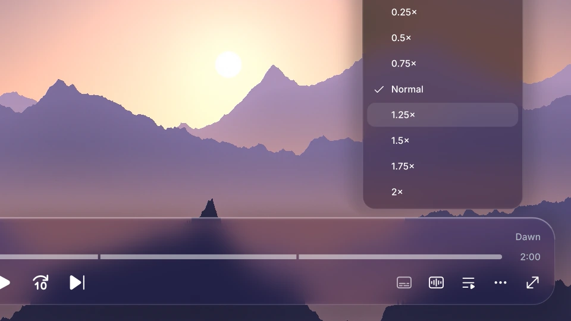</td>
    <td width="50%">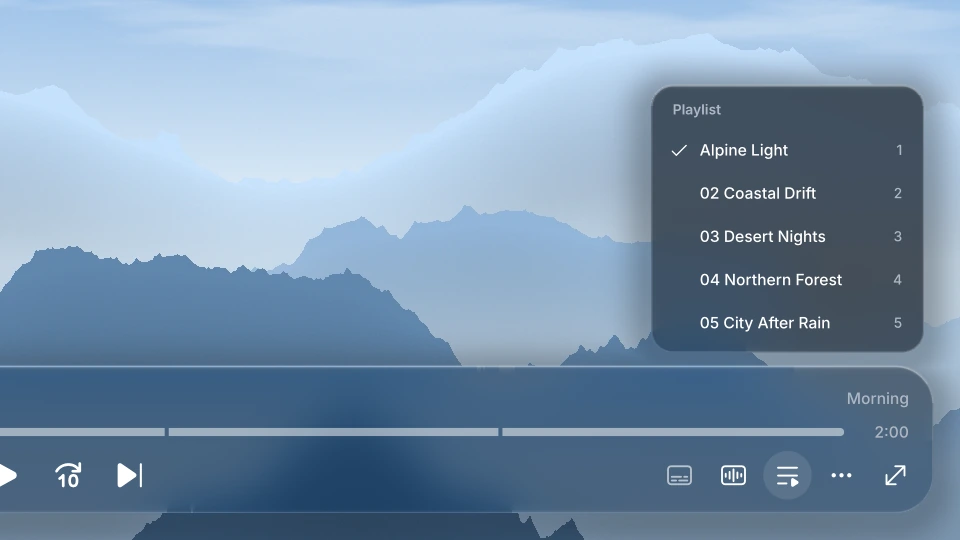</td>
  </tr>
  <tr>
    <td align="center"><sub>Playback speed, from the ⋯ menu</sub></td>
    <td align="center"><sub>Playlist, over a bright scene</sub></td>
  </tr>
</table>

<p align="center">
  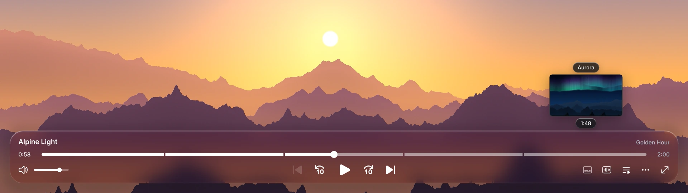
  <br><sub>Seekbar thumbnail with the chapter name and time</sub>
</p>

<table>
  <tr>
    <td width="70%">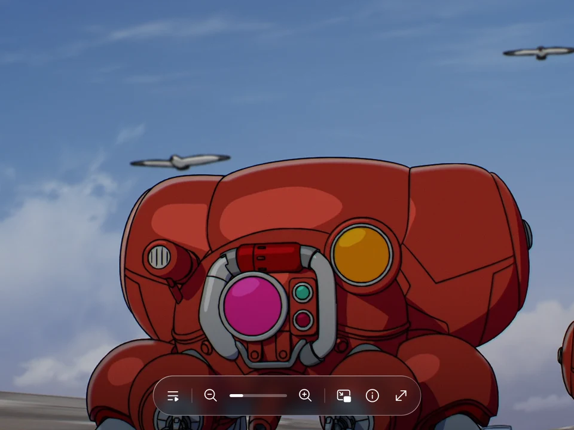</td>
    <td width="30%" align="center">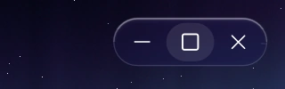</td>
  </tr>
  <tr>
    <td align="center"><sub>Image viewer with zoom controls</sub></td>
    <td align="center"><sub>Window controls in borderless mode</sub></td>
  </tr>
</table>

### Accessibility

<p align="center">
  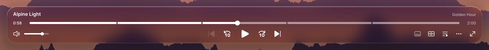
  <br><sub>Default</sub>
</p>
<p align="center">
  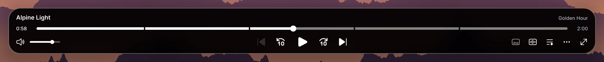
  <br><sub><code>glass_increase_contrast=yes</code></sub>
</p>
<p align="center">
  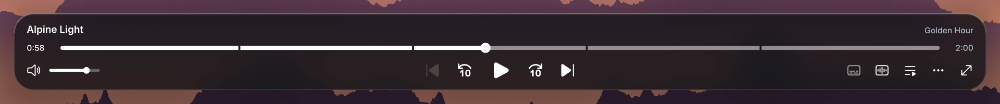
  <br><sub><code>glass_reduce_transparency=yes</code></sub>
</p>

`reduce_motion=yes` turns off the spring and scale animations. Fades are kept.

## thumbz

<p align="center">
  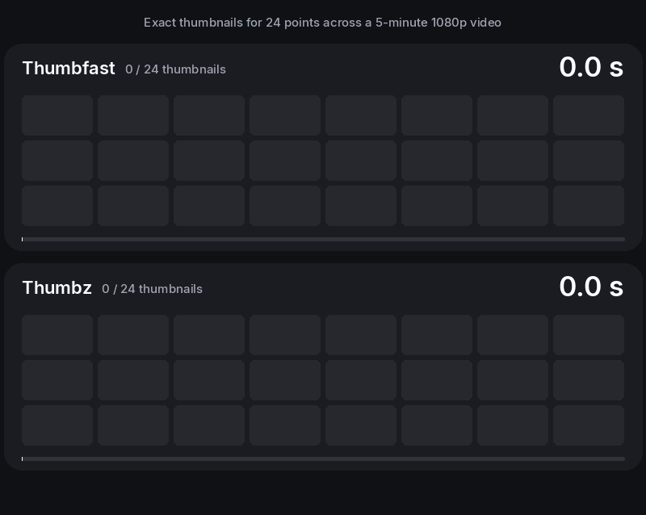
</p>

thumbz is a seekbar thumbnailer written for ModernGlass, as a replacement for thumbfast. It renders thumbnails in a second mpv that runs in the background. When the controls appear, it starts on thumbnails spread across the whole file. While you move along the seekbar it shows the closest finished one, and when you stop it renders the exact frame. Thumbnails are kept until the file changes.

| | thumbfast | thumbz |
| --- | :---: | :---: |
| Time for all 24 thumbnails | 12.8 s | 9.7 s |
| CPU time used | 14.6 s | 12.4 s |

<sub>Exact frames at 24 points of a 5-minute 1080p H.264 video, requested one after another. Default settings for both, software decoding on a 2-core machine, median of 5 runs. In 2 of the 5 runs thumbfast did not show the exact frame for the first point, and the test moved on after 8 s. thumbz also uses the player's hardware decoding when it is turned on.</sub>

## Installation

**1. Copy the files** into your mpv folder: `%APPDATA%\mpv` on Windows, `~/.config/mpv` on Linux, `~/Library/Application Support/mpv` on macOS.

| From this repository | To the mpv folder |
| --- | --- |
| `modernz.lua`, `thumbz.lua` | `scripts/` |
| `fonts/Inter-Medium.ttf`, `fonts/Inter-SemiBold.ttf` | `fonts/` |
| `modernz.conf`, `thumbz.conf` (optional) | `script-opts/` |

**2. Add these lines to `mpv.conf`:**

```ini
osc=no
vo=gpu-next
video-sync=display-resample
```

`osc=no` turns off mpv's own controls. `vo=gpu-next` is needed for the blur behind the panels; with other video outputs the panels are drawn without it. `video-sync=display-resample` redraws the controls at the display's refresh rate. With `border=no` the system title bar is removed and the script draws its own window buttons.

**Coming from ModernZ:** ModernGlass uses the same file names, options and script bindings, so it replaces `modernz.lua` and your `modernz.conf` and `input.conf` keep working. `modernz-icons.ttf` and `thumbfast.lua` are no longer used and can be deleted.

## Configuration

`modernz.conf` in `script-opts` lists every option with its default. It can also hold only the lines you change:

```ini
glass_opacity=40
panel_max_width=1400
seekbarfg_color=#0A84FF
```

| Option | Default | What it does |
| --- | --- | --- |
| `glass_color` | `#17181C` | panel color |
| `glass_opacity` | `30` | panel opacity in percent |
| `glass_blur` | `yes` | blur the video behind the panels |
| `glass_refraction` | `yes` | distortion near the edges and a highlight along the top edge |
| `glass_shadow` | `yes` | shadow under the panels |
| `panel_radius` | `28` | corner radius of the panel |
| `panel_max_width` | `0` | widest the panel gets (`0` = full width) |
| `vidscale_max` | `1.35` | maximum size of the controls, multiplied by the display scaling |

Every option is described in the [options guide](docs/USER_OPTS.md). ModernZ's other layouts (`classic`, `compact`, `mini`, `seekbar`) are available with `layout=`.

## Controls

Left click runs a button's main action, right click a second action, and middle click or <kbd>Shift</kbd>+click a third. The [controls guide](docs/CONTROLS.md) lists them all. ModernGlass adds no keyboard shortcuts; these can be added to `input.conf`:

```
v   script-binding modernz/visibility        # cycle visibility modes
w   script-binding modernz/progress-toggle   # toggle persistent progress
x   script-message-to modernz osc-show       # show the controls
y   script-message-to modernz osc-hide       # hide the controls
```

## More

- **Translations:** put [`modernz-locale.json`](extras/locale/modernz-locale.json) in `script-opts` and set `language=` in `modernz.conf`, for example `language=zh`. The [translations guide](docs/TRANSLATIONS.md) lists the languages.
- **Extra scripts:** ModernZ's [extras](extras/) (Open-File, Pause-Indicator-Lite, PiP-Lite) work with ModernGlass.

## Credits

ModernGlass is based on [ModernZ](https://github.com/Samillion/ModernZ) by Samillion. Project history:

- [Samillion/ModernZ](https://github.com/Samillion/ModernZ)
  - forked from [dexeonify/ModernX](https://github.com/dexeonify/mpv-config/blob/main/scripts/modernx.lua)
    - forked from [cyl0/ModernX](https://github.com/cyl0/ModernX)
      - forked from [maoiscat/mpv-osc-modern](https://github.com/maoiscat/mpv-osc-modern)
- [mpv](https://github.com/mpv-player/mpv) and its [osc.lua](https://github.com/mpv-player/mpv/blob/master/player/lua/osc.lua), which all of these are based on
- [Inter](https://rsms.me/inter/) by Rasmus Andersson, [SIL Open Font License 1.1](fonts/Inter-LICENSE.txt)
- [Fluent System Icons](https://github.com/microsoft/fluentui-system-icons) by Microsoft ([MIT](https://github.com/microsoft/fluentui-system-icons?tab=MIT-1-ov-file#readme)) and [Material Symbols](https://github.com/google/material-design-icons) by Google ([Apache 2.0](https://github.com/google/material-design-icons?tab=Apache-2.0-1-ov-file#readme))

The landscapes in the screenshots were generated for this README.

## License

[LGPL-2.1](LICENSE), like mpv's osc.lua that ModernGlass derives from. The Inter font files are under the [SIL Open Font License 1.1](fonts/Inter-LICENSE.txt).
